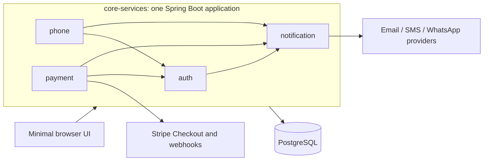

# PLAN

Implementation plan for `core-services`, derived from the project brief "Reusable Application Foundation: Main Points" (which includes the two-sprint "Reusable Authentication Service" build brief).

**Status as of 2026-10-22: planning only.** The repository contains the Gradle wrapper, `.gitignore`, this plan and the README. There is no build script, application code, migration, Docker file or test yet. Nothing has been built, run or reviewed, and nothing here should be read as production-ready.

| Phase | Scope | Status |
|---|---|---|
| 1 | Project skeleton, Docker Compose, PostgreSQL, Flyway V1-V2, configuration, health check | Not started (Gradle wrapper only) |
| 2 | Authentication, minimal demo UI and their tests | Not started |
| 3 | Notifications, phone OTP and their tests | Not started |
| 4 | Stripe Checkout, webhooks and payment tests | Not started |
| 5 | OpenAPI, completed README, CI, security checks | Not started (README and PLAN drafts exist) |

## 1. Goal and scope

Build one modular application (not microservices) that future products can reuse for authentication, notifications and one-off payments. Prioritise correctness, security and tests over visual polish.

**In scope**
- Authentication: email and password registration, login and logout with server-managed cookie sessions, expiring single-use password reset, protected `GET /api/me`, phone verification by OTP, minimal browser UI to demonstrate the flows.
- Notifications: reusable module with Email, SMS and WhatsApp provider interfaces, OTP delivery, payment confirmations, password-reset notifications.
- Payments: Stripe Checkout one-off payments with verified webhooks.
- Platform: Flyway migrations, Docker Compose, OpenAPI, automated tests that need no live credentials, README, CI, security checks.

**Out of scope**
- Phone-number/SMS login, Google/Microsoft sign-in, passkeys.
- Subscriptions and complex refund workflows.
- Complex roles, organisations, multi-tenancy.
- A polished frontend.
- A message queue (add one only when reliability or volume justifies it).

**Scope note.** The authentication brief marks payments and phone/SMS login as out of scope "for this sprint", while the foundation brief includes notifications, phone OTP and Stripe. The agreed scope is the full foundation, delivered in the brief's implementation order. Phone *verification* by OTP is in scope; phone-number *login* is not.

## 2. Architecture

Planned package layout under `com.example.coreservices` (group and package are placeholders to rename before reuse):

| Package | Responsibility |
|---|---|
| `common` | Clock, error responses, rate-limiting helper, hashing and token utilities |
| `security` | Spring Security configuration, authenticated principal, CSRF and session setup |
| `auth` | Users, registration, login, password reset, `/api/me` |
| `notification` | Provider interfaces and implementations, delivery service, preferences, status |
| `phone` | OTP challenges and verification |
| `payment` | Payments, Stripe provider, webhook handling |

Dependencies point inwards only: feature modules may use `common`, `security` and `notification`; `notification` does not depend on `auth`, `phone` or `payment`.

## 3. Technology

Versions were resolved on 2026-10-22 from Spring Initializr, the Spring Boot 4.1.1 dependency BOM and Maven Central. None has been compiled or run yet.

| Area | Choice |
|---|---|
| Language | Kotlin 2.3.21, JVM target 21 (local machine runs JDK 24) |
| Framework | Spring Boot 4.1.1 (Spring Framework 7, Spring Security 7, Jackson 3) |
| Build | Gradle wrapper 9.8.2, Kotlin DSL |
| Database | PostgreSQL 17, Flyway (managed by Boot), Spring `JdbcClient` (no ORM) |
| Password hashing | Argon2id via Spring Security, with BouncyCastle `bcprov-jdk18on` 1.86 (not managed by Boot) |
| Rate limiting | Bucket4j `bucket4j_jdk17-core` 8.21.0 with Caffeine (managed by Boot) |
| Email | Spring Mail (SMTP) |
| SMS / WhatsApp | HTTP providers behind interfaces (Twilio SMS; WhatsApp Business Platform Cloud API), called with Spring `RestClient` |
| Payments | `stripe-java` 34.0.0 (Stripe Checkout, webhook signature verification) |
| API docs | springdoc-openapi 3.1.1 (compatibility with Boot 4.1 to be verified) |
| Tests | JUnit Jupiter 6.0.3 (managed by Boot 4.1.1), MockK 1.14.11, Testcontainers 2.0.5 with PostgreSQL |
| Local environment | Docker Compose |

Deviation from the brief: it says JUnit 5; Spring Boot 4.1.1 manages JUnit Jupiter 6.0.3, so the managed version is used.

## 4. Data model (planned)

All primary keys are UUIDs. All timestamps are `timestamptz` and handled as UTC. Money is stored as integer minor units. Constraints and indexes are created by Flyway only.

| Table | Migration | Key columns and rules |
|---|---|---|
| `users` | V1 | `id`, `email` (unique, `CHECK (email = lower(email))`), `password_hash`, `status` (`ACTIVE`/`DISABLED`), `created_at`, `updated_at` |
| `password_reset_tokens` | V2 | `id`, `user_id` (FK to `users`), `token_hash` (unique, SHA-256 of the token), `expires_at`, `used_at` (null until consumed), `created_at`; indexes on lookup columns |
| `notifications` | V3 | `id`, `user_id` (nullable FK), `channel`, `type`, `recipient`, `status` (`PENDING`/`SENT`/`FAILED`/`SUPPRESSED`), `provider`, `provider_message_id`, `attempts`, sanitised `last_error`, timestamps. Never stores OTPs, reset tokens or message bodies containing them |
| `notification_attempts` | V3 | `notification_id` (FK), `attempt_number`, `outcome`, sanitised error, `started_at`, `finished_at`; unique on (`notification_id`, `attempt_number`) |
| `notification_preferences` | V3 | `user_id` (FK), `channel`, `enabled`, `consent_recorded_at`, `updated_at`; primary key (`user_id`, `channel`) |
| `users` (extended) | V4 | nullable `phone_number` (E.164) and `phone_verified_at` |
| `phone_verification_challenges` | V4 | `id`, `user_id` (FK), `phone_number`, `code_hash` (HMAC), `attempts`, `max_attempts`, `expires_at`, `consumed_at`, `created_at` |
| `payments` | V5 | `id`, `user_id` (FK), `amount_minor` (`CHECK > 0`), `currency` (3-letter lower case), `status`, `provider`, `provider_session_id` (unique), `provider_payment_intent_id`, `paid_at`, timestamps |
| `payment_webhook_events` | V5 | `provider`, `provider_event_id` (unique together), `event_type`, nullable `payment_id` (FK), `outcome`, `received_at`, `processed_at`. Raw payloads are not stored (data minimisation) |

`notification_attempts` is an addition to the brief's suggested table list, needed to "record delivery attempts, status and errors".

## 5. API outline (planned)

| Endpoint | Access | Phase |
|---|---|---|
| `GET /actuator/health` | anonymous | 1 |
| `POST /api/auth/register` | anonymous | 2 |
| `POST /api/auth/login` | anonymous | 2 |
| `POST /api/auth/logout` | session | 2 |
| `POST /api/auth/password-reset/request` | anonymous | 2 |
| `POST /api/auth/password-reset/confirm` | anonymous | 2 |
| `GET /api/me` | session | 2 |
| `POST /api/phone/verification/start` and `/confirm` | session | 3 |
| `GET /api/notifications`, `GET`/`PUT /api/notifications/preferences` | session, own data only | 3 |
| `POST /api/payments`, `GET /api/payments`, `GET /api/payments/{id}` | session, own data only | 4 |
| `POST /api/webhooks/stripe` | Stripe signature only, CSRF-exempt | 4 |
| `GET /v3/api-docs` (Swagger UI only in the `local` profile) | anonymous | 5 |

## 6. Security decisions (planned, not yet implemented)

- **Passwords:** Argon2id with at least the OWASP minimum (19 MiB memory, 2 iterations, 1 lane); length 12 to 128; never logged or returned.
- **Sessions:** server-side `HttpSession` with `HttpOnly`, `Secure` (disabled only in the `local` profile) and `SameSite=Lax` cookies; session id rotated on login; 30-minute idle timeout; logout invalidates the session and clears the cookie; a `SessionRegistry` expires a user's other sessions after a password reset.
- **CSRF:** Spring Security cookie token with the SPA pattern (`XSRF-TOKEN` cookie, `X-XSRF-TOKEN` header). Only the Stripe webhook is exempt and is authenticated by signature.
- **Rate limiting:** login, registration and password-reset requests limited by client IP and normalised email (Bucket4j and Caffeine, in memory per instance). Messaging limits are counted from the `notifications` table so they survive restarts and instances.
- **Enumeration:** identical responses for unknown, wrong-password and disabled accounts at login, and for known and unknown emails on reset requests. Registration of an existing email returns 409 (accepted trade-off; email verification needs the notification module and is not in the brief).
- **Reset tokens:** 32 random bytes, only the SHA-256 hash stored, 30-minute expiry, consumed with one atomic `UPDATE ... WHERE used_at IS NULL AND expires_at > now()`.
- **OTP:** 6 digits from `SecureRandom`, stored as HMAC-SHA-256 keyed with a server-side secret and bound to the challenge and phone number, 10-minute expiry, 5 attempts, single use, resend cooldown.
- **Notifications:** provider interfaces; bounded retries (3 attempts, exponential backoff, request timeouts); OTPs and reset links are passed to providers in memory only and are never persisted or logged. Email is on by default, SMS and WhatsApp require recorded opt-in; security-critical messages (password reset, OTP) ignore opt-out but not rate limits. Password-reset messages are dispatched asynchronously so response timing does not reveal whether an account exists.
- **Payments:** amounts and currency are decided server-side; status changes only from signature-verified webhooks; duplicate events are ignored via a unique event id inside the same transaction as the status change; amount and currency from the event are checked against the stored payment; terminal states are immutable; other users' payments return 404. The browser success page never marks a payment as paid. Test mode only until a security review.
- **Secrets and infrastructure:** secrets come from environment variables only, with no default values; `.env` is git-ignored; Compose binds PostgreSQL to `127.0.0.1`; a least-privilege runtime database account is documented; HTTPS is required in production and terminated outside the app.

## 7. Phases

### Phase 1: skeleton, database, Docker
- `settings.gradle.kts`, `build.gradle.kts`, application class, `application.yml` and `application-local.yml`.
- `compose.yaml` (PostgreSQL 17, localhost-only port, health check, named volume) and `.env.example`.
- Flyway `V1__create_users_table.sql` and `V2__create_password_reset_tokens_table.sql`.
- Health check at `/actuator/health`; no other actuator endpoint exposed.
- Tests: context loads against a Testcontainers PostgreSQL; migrations apply to an empty database.
- **Done when:** the application starts, migrations run cleanly and `./gradlew test` passes.

### Phase 2: authentication and demo UI
- Registration, login, logout, password reset request and confirm, `GET /api/me`, rate limiting, CSRF, session configuration, safe JSON error responses.
- Until Phase 3, reset links go through a `PasswordResetSender` interface with a logging implementation enabled only in the `local` and `test` profiles.
- Minimal static UI for register, login, logout, reset request and reset confirm.
- **Done when:** core success and failure tests pass; reset tokens expire and cannot be reused; anonymous requests to `/api/me` are rejected.

### Phase 3: notifications and phone OTP
- Migrations V3 and V4; provider interfaces with SMTP email, Twilio SMS and WhatsApp Cloud API implementations, plus logging providers for `local` and `test`.
- Notification service: provider selection, consent and preference policy, rate limits, bounded retries, attempts, status and errors recorded.
- Password-reset notifications move onto the notification service; OTP start and confirm endpoints; preference and status endpoints with ownership checks.
- **Done when:** provider-mocked tests cover delivery, failure, retries, preferences, permissions and status; OTP expiry, wrong attempts, single use and rate limits are tested.

### Phase 4: Stripe payments
- Migration V5; `PaymentProvider` interface with a Stripe implementation; fake provider for tests.
- Create payment and Checkout Session, webhook endpoint with signature verification, idempotent event handling, status state machine, payment confirmation notification after the first successful transition.
- **Done when:** tests cover amount validation, checkout creation, ownership, signature checks, duplicate events, status transitions and provider failures, with no live Stripe credentials.

### Phase 5: documentation, CI, security checks
- springdoc OpenAPI plus a test guarding the documented paths.
- README completed with commands that have actually been run: setup, configuration, migrations, tests, deployment.
- GitHub Actions: build and test on JDK 21 with Docker available for Testcontainers; dependency vulnerability check; secret scanning.
- Security review against the brief's checklist; honest known-limitations and hardening list.
- **Done when:** a fresh clone can be started and tested using the documented steps.

## 8. Test plan

| Component | Essential tests (from the brief) |
|---|---|
| Authentication | Registration, password hashing, login failures, logout, session security, password reset, token expiry, rate limits |
| Payments | Amount validation, checkout creation, ownership checks, webhook signatures, duplicate events, status transitions, provider failures |
| Notifications | Provider selection, successful delivery, failures, retries, preferences, permissions, delivery status |
| Phone OTP | Code generation, hashing, expiry, incorrect attempts, single-use verification, rate limits |
| Database | Flyway migrations, constraints, transactions, rollback |
| API security | Authentication, authorisation, invalid input, safe error responses, secret leakage |

Providers are mocked or faked everywhere; the suite must not need live Stripe, SMS, email or WhatsApp credentials. Integration tests use Testcontainers PostgreSQL. Unit tests use MockK.

## 9. Assumptions

- Group `com.example` and package `com.example.coreservices` are placeholders.
- Proposed defaults (all configurable, to be tuned): password length 12 to 128; reset token 30 minutes; OTP 10 minutes, 6 digits, 5 attempts, 60-second resend cooldown; login limit 5 attempts per 15 minutes per email and 20 per 15 minutes per IP; messaging limit 5 per hour per recipient and channel and 20 per day per user; notification retries 3 attempts.
- Registration does not verify email ownership in v1 (not in the brief); accounts are active immediately. This is a known limitation.
- Sessions live in memory: they are lost on restart and not shared across instances. Spring Session JDBC is the documented upgrade path.
- Rate-limit buckets for login and password reset are per instance. The client IP is taken from the connection unless a trusted proxy is configured.
- Phone numbers are not required to be unique across users.
- Stripe minimum amounts and supported currencies must be confirmed against Stripe's documentation when Phase 4 starts.
- WhatsApp business-initiated messages need pre-approved templates; free-form text only works inside the 24-hour customer-service window. The provider interface keeps this replaceable.
- Raw provider payloads are not stored.

## 10. Risks

- Spring Boot 4, Spring Security 7, Jackson 3 and Testcontainers 2 are new major versions; API differences are expected and will be resolved against the compiler and tests.
- Testcontainers must work with the local Docker 29.9.2; to be verified in Phase 1.
- springdoc 3.1.1 and MockK compatibility with Boot 4.1 are unverified.
- Stripe, SMS, email and WhatsApp integrations can only be tested against fakes or local stubs without credentials. Live verification in test mode is a pre-production task.

## 11. Definition of done

- [ ] The service runs from documented setup instructions.
- [ ] Registration, login, logout and password reset work end to end.
- [ ] Passwords and reset tokens are not stored in plaintext.
- [ ] The schema is created by Flyway and verified by automated integration tests.
- [ ] PostgreSQL is not publicly exposed by default.
- [ ] Notifications, OTP and payments meet their tests with mocked providers.
- [ ] Known limitations and production hardening tasks are documented honestly.

## 12. Working agreements

Work in small steps and run tests after each meaningful change. Use framework security features rather than custom security code and never invent cryptography. Record the exact commands and results below. Document assumptions instead of silently inventing requirements. Do not claim production readiness without evidence.

## 13. Verification log

Append the exact command and result for each verified step.

| Date | Command | Result |
|---|---|---|
| 2026-10-22 | `java -version` | OpenJDK 24.0.1 |
| 2026-10-22 | `gradle --version` | Gradle 8.14.4 (system install); the project wrapper targets 9.8.2 and has not been run |
| 2026-10-22 | `docker --version`, `docker ps` | Docker 29.9.2; daemon reachable by the current user |
| 2026-10-22 | `curl -sI https://repo.maven.apache.org/maven2/` | HTTP 200 (Maven Central reachable) |

No build or test has been run yet.
